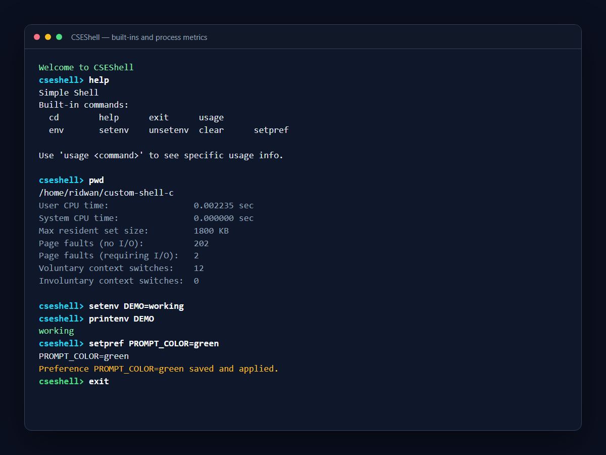
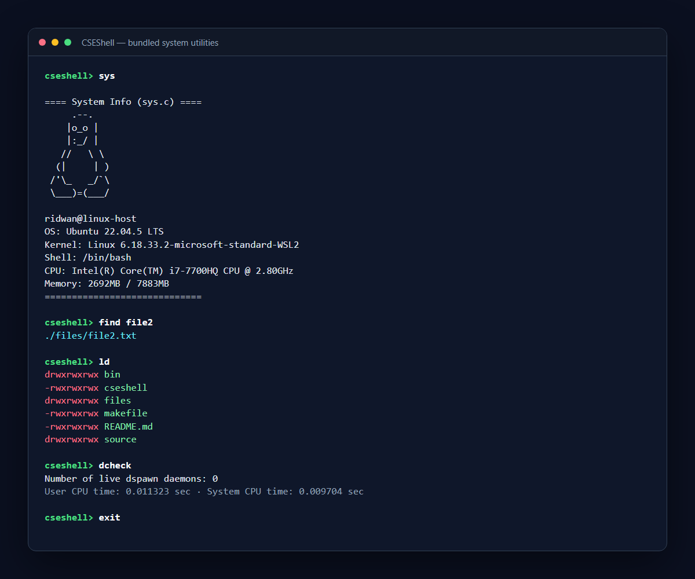
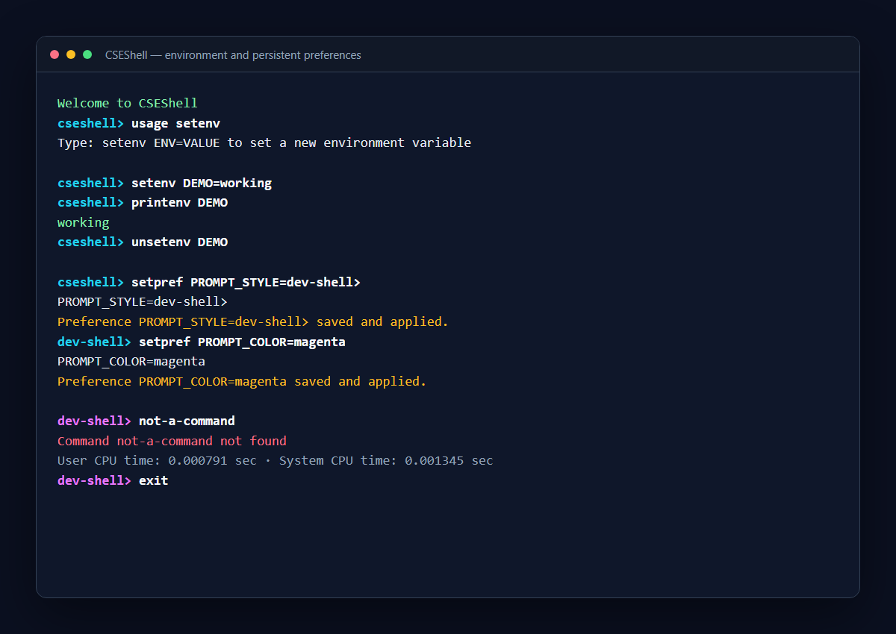
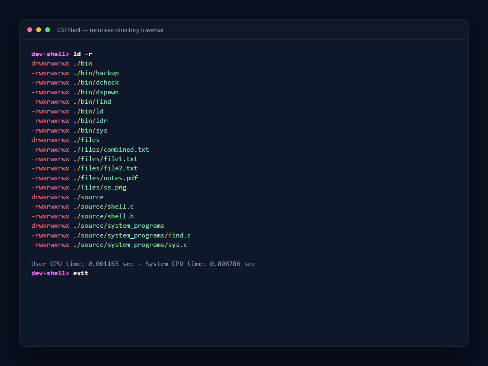
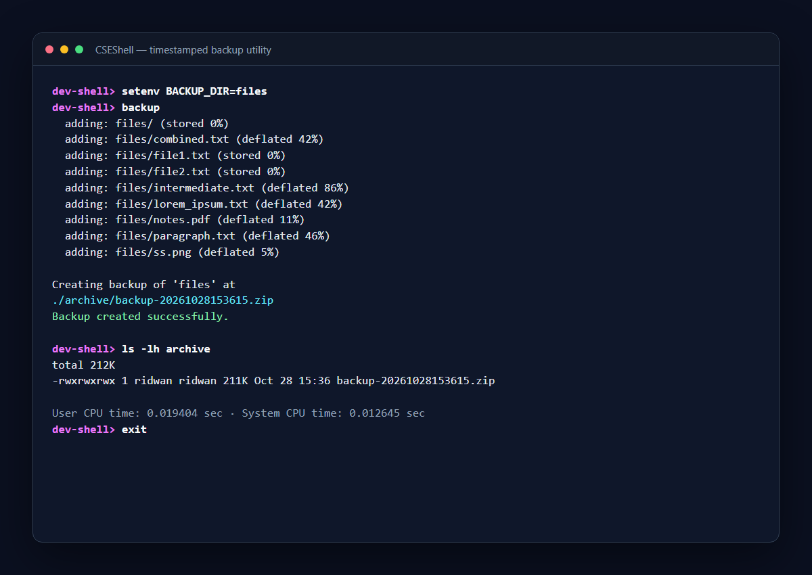

# CSEShell

CSEShell is a custom Unix shell written in C. It combines an interactive command loop with built-in commands, external process execution, persistent interface preferences, startup configuration, resource-usage reporting, tab completion, and a collection of supporting system utilities.

The project is designed for Linux and other Unix-like environments. It can also be built on Windows through WSL.

## Features

- Execute standard programs and project utilities through `fork`, `execvp`, and `waitpid`
- Continue accepting commands after each child process finishes
- Navigate directories with the built-in `cd` command
- Inspect, create, and remove environment variables
- Load startup commands and a custom executable path from `.cseshellrc`
- Persist prompt and colour preferences in `.cseshell_profile`
- Recall command history and complete built-ins or project utilities with GNU Readline
- Report CPU time, memory use, page faults, and context switches after external commands
- Search and list files with bundled Unix-style system programs
- Display system information, create timestamped backups, and exercise daemon management

## Architecture and code design

The shell uses a modular procedural design suited to C systems programming:

- **Command input and parsing** use GNU Readline for editable input, history, and tab completion. Input is tokenised into the `argv`-style array expected by Unix process APIs.
- **Built-in dispatch** uses parallel command and function-pointer tables. Commands that must modify shell state—such as `cd`, `setenv`, `unsetenv`, and `setpref`—run inside the parent process instead of a child.
- **External command execution** follows the standard Unix process lifecycle: the shell calls `fork`, the child replaces itself with `execvp`, and the parent synchronises with `waitpid` before displaying the next prompt.
- **Configuration management** separates startup commands (`.cseshellrc`) from persistent visual preferences (`.cseshell_profile`). The `setpref` built-in validates changes, applies them immediately, and updates the profile through a temporary file and atomic rename.
- **Resource instrumentation** uses `getrusage(RUSAGE_CHILDREN)` to report user and system CPU time, peak resident memory, page faults, and voluntary or involuntary context switches.
- **System programs** are compiled as independent executables under `bin/`. This keeps recursive search, directory listing, backup, system-information, and daemon exercises separate from the core shell.

### Execution flow

```text
Readline input
     |
Tokenise command
     |
     +-- Built-in command --> function-pointer dispatch --> update shell state
     |
     `-- External command --> fork --> execvp in child
                                    `-> waitpid in parent --> resource report
```

This design demonstrates process creation, program replacement, parent-child synchronisation, environment management, file handling, function pointers, and separation of responsibilities across small C programs.

## Built-in commands

| Command | Purpose |
| --- | --- |
| `cd <directory>` | Change the shell's current working directory |
| `help` | List available built-ins |
| `usage <command>` | Display command-specific guidance |
| `env` | Print the current environment |
| `setenv NAME=VALUE` | Create or replace an environment variable |
| `unsetenv NAME` | Remove an environment variable |
| `setpref KEY=VALUE` | Change and persist prompt or colour preferences |
| `clear` | Clear the terminal |
| `exit` | Exit gracefully |

Supported preference keys are `PROMPT_STYLE`, `PROMPT_COLOR`, `TEXT_COLOR`, and `ERROR_COLOR`.

## Bundled system programs

| Program | Purpose |
| --- | --- |
| `find <keyword>` | Recursively find filenames containing a keyword |
| `ld` | List visible entries and Unix permissions |
| `ld -r` / `ldr` | Recursively list visible files and directories |
| `sys` | Display OS, kernel, uptime, CPU, memory, and user information |
| `backup` | Create a timestamped ZIP of `BACKUP_DIR` under `archive/` |
| `dspawn` | Demonstrate double-fork daemon creation and logging |
| `dcheck` | Count active `dspawn` daemon processes |

## Project structure

```text
.
|-- source/
|   |-- shell.c                 # Main loop, process execution, completion and metrics
|   |-- shell.h                 # Built-ins and preference management
|   `-- system_programs/        # Independent system utilities
|-- files/                      # Sample files for search and listing demonstrations
|-- docs/screenshots/           # Verified command-session captures
|-- .cseshellrc                 # Startup path and commands
|-- .cseshell_profile           # Persistent interface preferences
`-- makefile                    # Builds the shell and bundled utilities
```

## Build and run

Install a C compiler, Make, GNU Readline development headers, and ncurses development headers. On Ubuntu or WSL:

```bash
sudo apt update
sudo apt install build-essential libreadline-dev libncurses-dev zip
```

Build and start the shell:

```bash
make
./cseshell
```

Clean generated binaries with:

```bash
make clean
```

## Example session

```text
cseshell> help
cseshell> sys
cseshell> find file2
cseshell> setenv DEMO=working
cseshell> printenv DEMO
working
cseshell> setpref PROMPT_COLOR=green
cseshell> exit
```

## Screenshots

### Built-ins, external commands, and resource reporting



### Custom system utilities



### Environment variables and persistent preferences



### Recursive directory traversal



### Timestamped backups


